# Chromancy Theming

Chromancy Theming applies one palette and one set of fonts across the GNOME desktop: libadwaita and
GTK 3 apps, the GNOME Shell menus and panel, Qt and Flatpak apps, and the config files of apps that keep
their own colors, such as terminals. It keeps Ubuntu's Yaru look and changes its colors, and Restore puts
everything back as it was.

It is distributed through [GitHub releases](https://github.com/Excelsies/chromancy-theming/releases), not
through an app store or a package repository.

## Screenshots

Jeweltone Dark and Jeweltone Light, two of the 50 built-in palettes:

| | Jeweltone Dark | Jeweltone Light |
|---|---|---|
| Chromancy Theming | 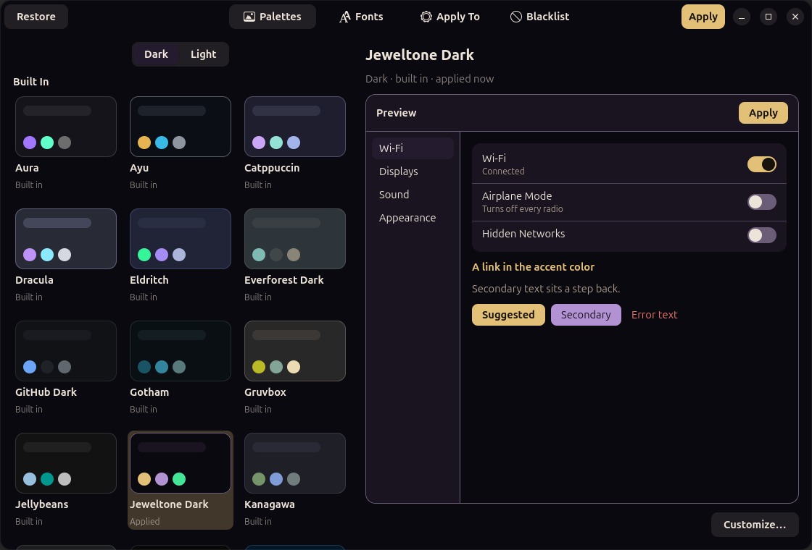 | 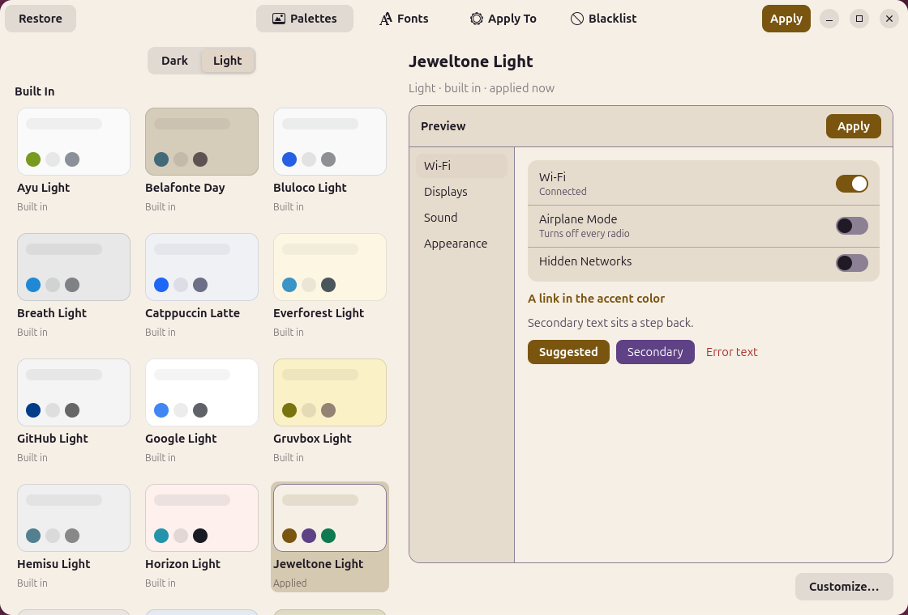 |
| Settings (libadwaita) | 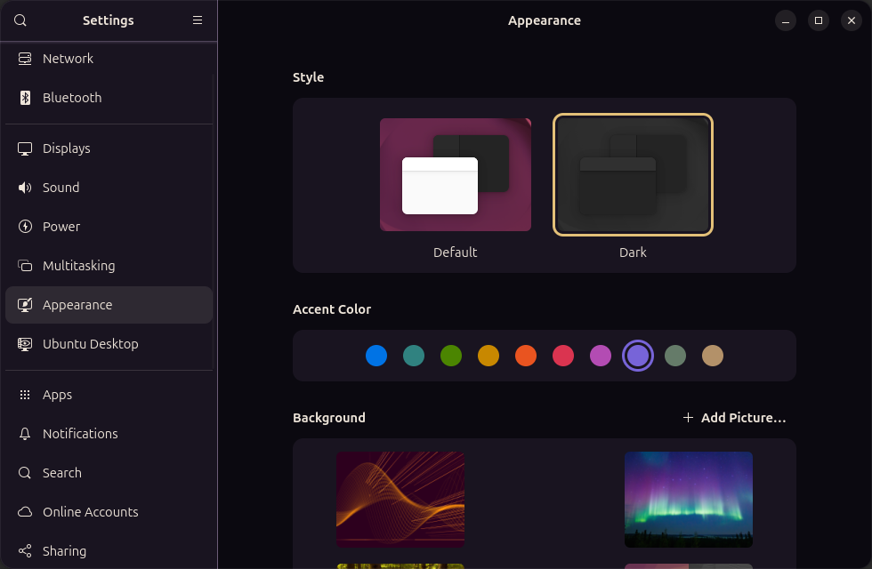 | 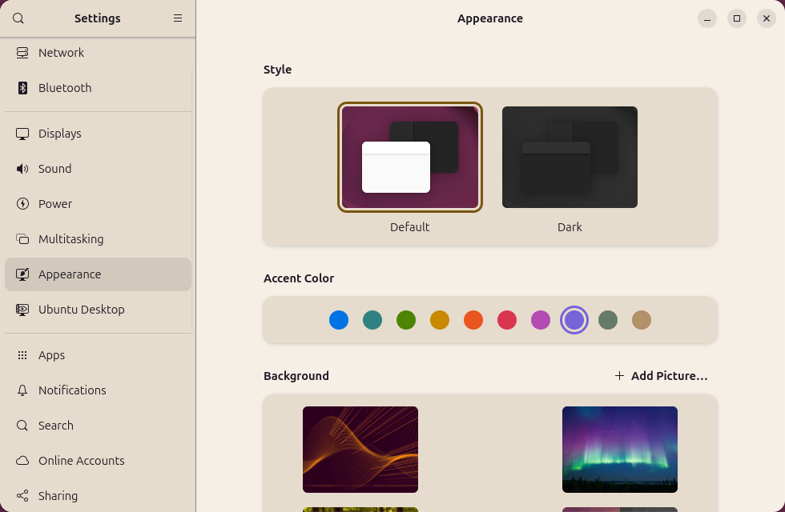 |
| Files | 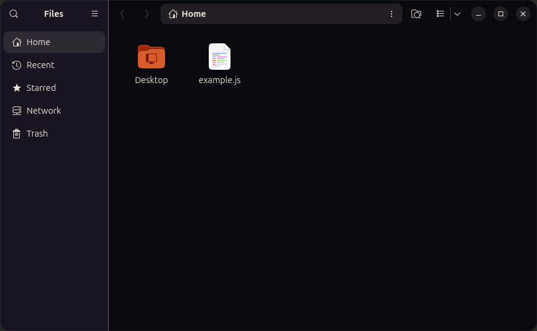 | 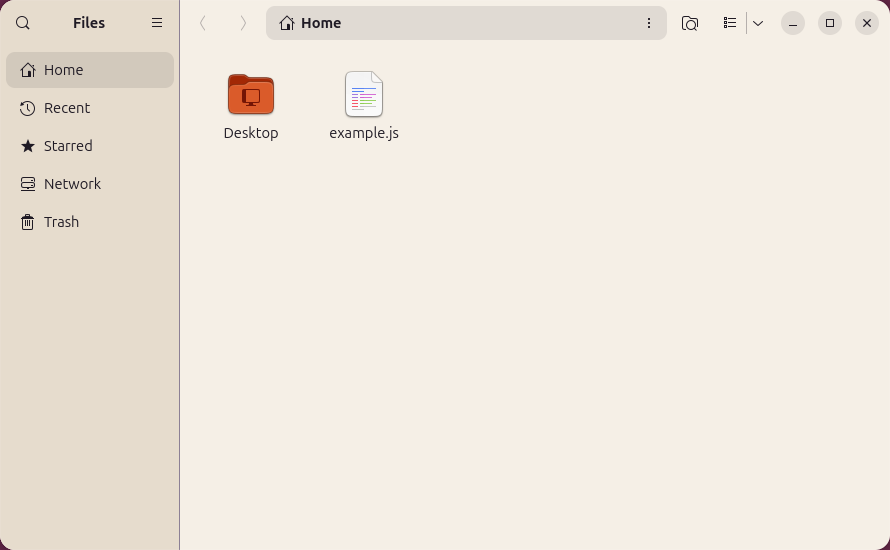 |
| Text Editor | 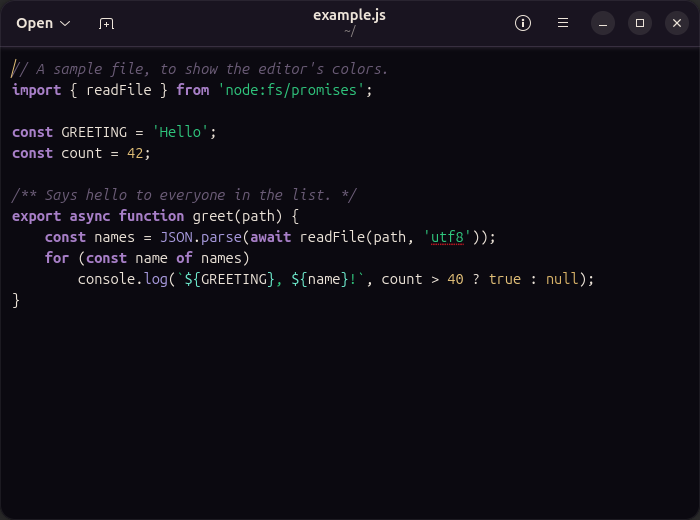 | 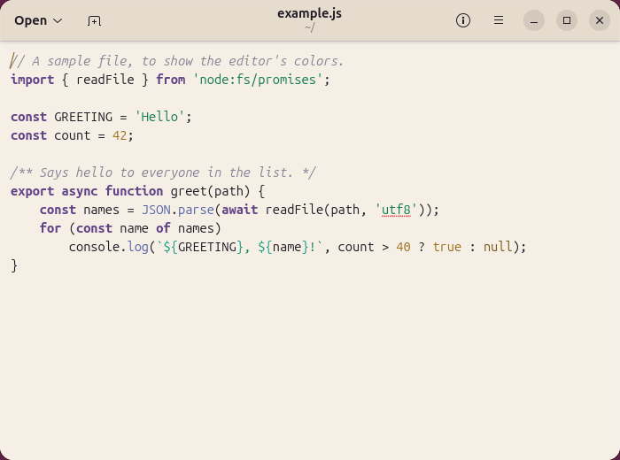 |
| Ptyxis terminal | 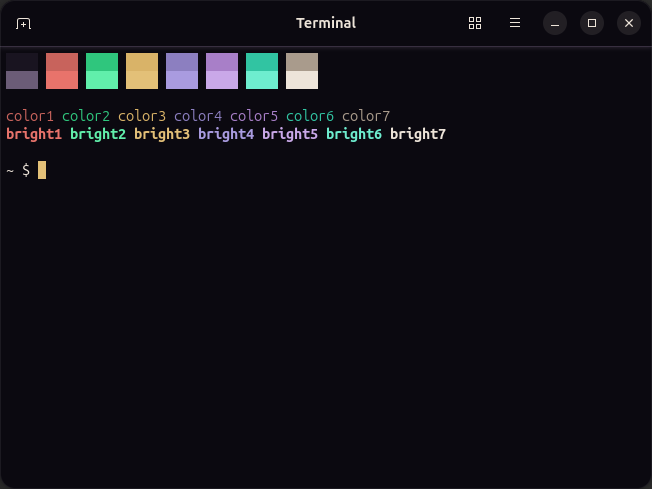 | 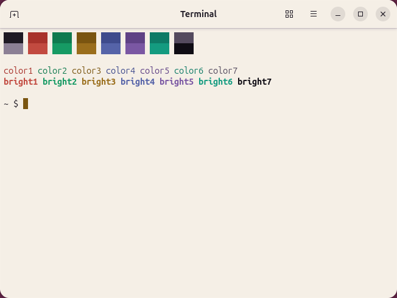 |
| Calendar (GNOME Shell) | 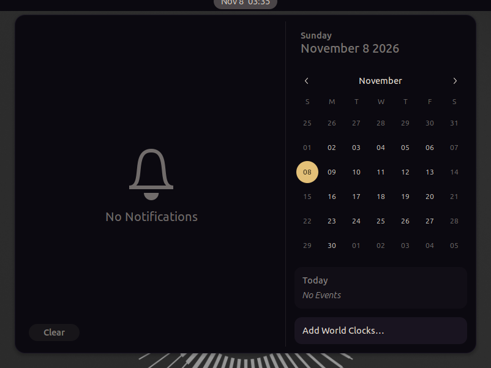 | 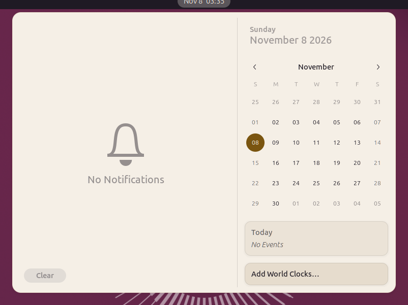 |
| Qt (qt6ct) | 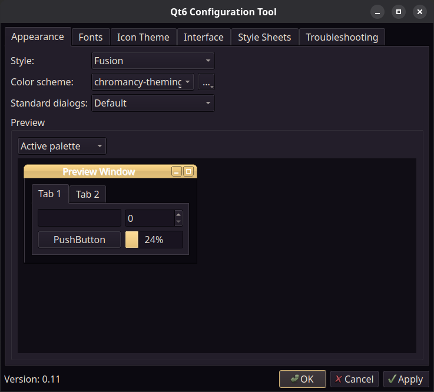 | 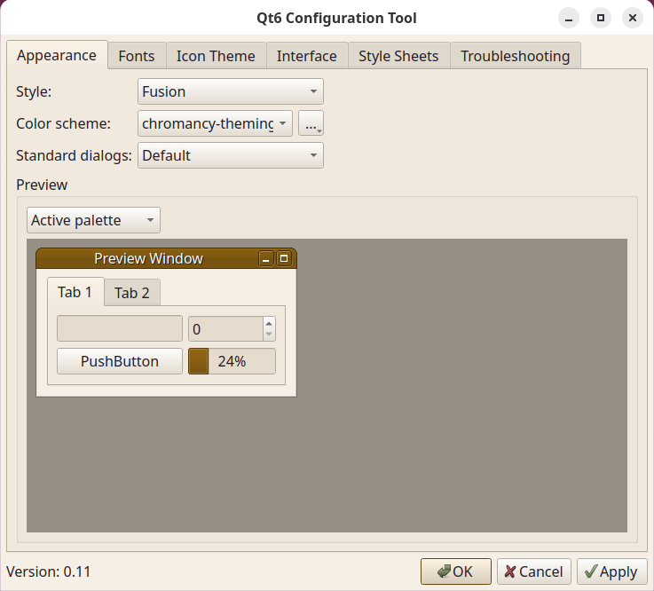 |

## Requirements

- GNOME Shell 50 on Ubuntu 26.04 with the Yaru theme (the GTK 3 and shell themes are rebuilt from
  Yaru's source).
- `gjs` and libadwaita 1.9 (`gir1.2-adw-1`), which Ubuntu's desktop already has.
- `sassc`, to rebuild Yaru with a palette, and librsvg's bindings (`gir1.2-rsvg-2.0`, which GNOME Shell
  already needs), to redraw its accent images.
- `bwrap` (`bubblewrap`), to keep blacklisted apps out of the theme.
- Optional: `qt6ct`, for Qt apps.

```sh
sudo apt install gjs gir1.2-adw-1 gir1.2-rsvg-2.0 sassc bubblewrap qt6ct
```

Or through PackageKit's `pkgcli`, which asks for authorization itself instead of needing `sudo`:

```sh
pkgcli install gjs gir1.2-adw-1 gir1.2-rsvg-2.0 sassc bubblewrap qt6ct
```

## Installation

Chromancy runs from its own folder: the launcher, the shell extension and the blacklist's launchers point
into it, so put it somewhere it can stay. Nothing is installed outside your home directory and nothing
needs `sudo` (beyond the requirements above).

1. **From a release:** download `chromancy-theming-<version>.tar.gz` from the
   [latest release](https://github.com/Excelsies/chromancy-theming/releases/latest) (or with
   `gh release download -R Excelsies/chromancy-theming -p '*.tar.gz'`), then extract it and install:

   ```sh
   mkdir -p ~/.local/opt
   tar -xzf chromancy-theming-*.tar.gz -C ~/.local/opt
   ~/.local/opt/chromancy-theming/tools/install.sh
   ```

   **From a checkout** instead (for development):

   ```sh
   git clone git@github.com:Excelsies/chromancy-theming.git ~/Apps/chromancy-theming
   ~/Apps/chromancy-theming/tools/install.sh
   ```

   `tools/install.sh` writes `~/.local/share/applications/io.github.excelsies.ChromancyTheming.desktop`
   and links `~/.local/share/gnome-shell/extensions/chromancy-theming@excelsies` to the folder's
   `extension/`. Run from another folder later, it points both there instead.

2. Log out and back in, so GNOME Shell finds the new extension, then enable it:

   ```sh
   gnome-extensions enable chromancy-theming@excelsies
   ```

   The extension loads the shell theme and powers **Pick a Window** on the Blacklist page. Everything
   else works without it, but the panel, menus and notifications then keep their stock colors; the
   window shows a banner while it is not running.

3. Open **Chromancy Theming** from the app grid, pick a palette and press **Apply**.

The command line used below is `bin/chromancy-theming` in that folder
(`~/.local/opt/chromancy-theming/bin/chromancy-theming` for a release install).

### Updating

From a release, replace the folder with the new one:

```sh
rm -rf ~/.local/opt/chromancy-theming
tar -xzf chromancy-theming-*.tar.gz -C ~/.local/opt
```

From a checkout, `git pull`. Either way, press **Apply** again so the rebuilt themes pick up the changes; a
change to the extension takes effect at the next login.

### Uninstalling

From the Chromancy folder:

```sh
bin/chromancy-theming restore      # put every file and setting back as it was
gnome-extensions disable chromancy-theming@excelsies
tools/install.sh --remove          # the launcher and the extension link
```

Then delete the folder. `~/.config/chromancy-theming` (your palettes, templates and settings) and
`~/.local/state/chromancy-theming` (what Restore needs) can be deleted after the restore.

## Usage

The window has four pages:

- **Palettes**: the built-in palettes in Dark and Light tabs, with your own above them. Selecting one
  shows a live preview; **Customize…** saves an edited copy as your own palette, and the trash button on
  your own deletes it.
- **Fonts**: interface, document and monospace fonts that replace the palette's.
- **Apply To**: which targets (below) Apply and Restore work on.
- **Blacklist**: apps kept out of the theme.

**Apply** applies the selected palette to the enabled targets; **Restore** puts them back. Every app that
is already open keeps its colors until it restarts; the shell changes at once.

The same from a terminal, using the targets and fonts chosen in the window:

```sh
bin/chromancy-theming list                      # the palettes, built-in and your own
bin/chromancy-theming apply jeweltone-dark      # apply one to the enabled targets
bin/chromancy-theming apply nord --targets=gtk4,style
bin/chromancy-theming restore                   # put everything back as it was
bin/chromancy-theming restore qt ptyxis         # or only some targets
```

Each line of output names a target, a status (`applied`, `unchanged`, `restored`, `skipped`, `locked` or
`failed`) and what it is about. The exit status is 1 when a target failed or was locked.

## What it themes

| Target | What it changes |
|---|---|
| `style` | GNOME's light/dark preference, from the palette's variant |
| `gtk4` | GTK 4 and libadwaita apps: `~/.config/gtk-4.0/chromancy-theming.css`, imported from `gtk.css` |
| `gtk3` | GTK 3 apps: Yaru rebuilt with the palette, in `~/.config/gtk-3.0/`, imported from `gtk.css` |
| `shell` | GNOME Shell: Yaru's shell theme rebuilt with the palette, loaded by the extension |
| `fonts` | The interface, document and monospace fonts, when the palette or the Fonts page sets them |
| `flatpak` | Lets Flatpak apps read the GTK stylesheets (a read-only grant in `~/.local/share/flatpak/overrides/global`) |
| `qt` | Qt apps through qt6ct: a color scheme selected in `qt6ct.conf`, and `QT_QPA_PLATFORMTHEME=qt6ct` from the next login |
| `conjure` | Conjure Launcher's colors, through its theming keys, unless it is set to keep its own |
| `plaid` | Plaid's active, unfocused and scratchpad window borders |
| `ptyxis` | A palette of its own, selected in Ptyxis's default profile |
| `btop` | A theme, selected in `btop.conf` |
| `text-editor` | A style scheme for Text Editor's writing area, from the terminal colors |
| `templates` | Your own templates (below) |
| `blacklist` | Keeps the apps on the blacklist out of the theme (below) |

Snap apps read the same `gtk.css` as the rest, so the `gtk4` and `gtk3` targets cover them.

A target whose app is not installed is skipped. Ptyxis, btop and Text Editor need the palette's terminal
colors; with a palette that has none they go back to how they were before Chromancy. Conjure Launcher has
a switch that keeps other apps from changing its theme; while it is on, the `conjure` target reports
`locked` and changes nothing. In the window, `conjure` and `plaid` share one **Shell extensions** switch.

Chromancy sets colors directly, so any accent works. It does not change GNOME's own accent-color setting.

## Palettes

There are 25 dark and 25 light built-in palettes in `data/palettes/`. Your own go in
`~/.config/chromancy-theming/palettes/<id>.json` (the window's **Customize…** writes them there); one
with a built-in's id replaces it.

```json
{
  "name": "My Palette",
  "variant": "dark",
  "colors": {
    "primary": "#e3c078",
    "surface": "#0f0c14",
    "on-surface": "#e8e2d6"
  },
  "fonts": { "interface": "Ubuntu 11", "monospace": "Ubuntu Mono 13" }
}
```

Only `primary`, `surface` and `on-surface` are required; Chromancy derives the other roles from them.
Terminal colors (`"terminal"`: background, foreground and 16 ANSI colors) are optional. The full list of
roles, how derivation works and the contrast checks are in
[docs/architecture.md](docs/architecture.md#palettes). A palette that does not parse is listed with its
error, never applied.

## Keeping apps out of the theme

The **Blacklist** page adds an app from a list, or by clicking one of its windows (**Pick a Window**,
which needs the shell extension); each addition is confirmed first. From a terminal:

```sh
bin/chromancy-theming blacklist                                  # list
bin/chromancy-theming blacklist add org.gnome.Calculator.desktop
bin/chromancy-theming blacklist remove org.gnome.Calculator.desktop
```

A blacklisted app keeps its own colors from its next start:

- a regular app starts through `bin/chromancy-theming-unthemed` (a copy of its launcher in
  `~/.local/share/applications`, and of its D-Bus service when it has one), which hides Chromancy's
  stylesheets from that app only; your own `gtk.css` rules still apply. Started from a terminal, it is
  themed as usual;
- a Flatpak app is denied the GTK stylesheet folders (`~/.local/share/flatpak/overrides/<app-id>`);
- a Snap app's own `gtk.css` links point at a copy of your `gtk.css` without Chromancy's line (the Snap
  must have run once first);
- Ptyxis, btop and Text Editor keep their own colors: their targets are skipped.

Taking an app off the blacklist, or Restore, removes all of it.

## Your own templates

Files in `~/.config/chromancy-theming/templates/*.tmpl` are filled with the palette and written where their
first line says, inside your home directory:

```
chromancy-output: ~/.config/kitty/chromancy.conf
background {{term-background}}
foreground {{term-foreground}}
color1 {{ansi1}}
```

Every color has a name: `{{primary}}`, `{{on-primary}}`, `{{surface}}`, `{{surface-container}}`,
`{{on-surface}}`, `{{on-surface-variant}}`, `{{outline-variant}}`, `{{hover}}`, `{{on-hover}}`,
`{{secondary}}`, `{{on-secondary}}`, `{{tertiary}}`, `{{on-tertiary}}`, `{{inactive-border}}`,
`{{error}}`, `{{destructive}}`, `{{success}}`, `{{warning}}`; with terminal colors, `{{term-background}}`,
`{{term-foreground}}`, `{{term-cursor}}`, `{{term-cursor-text}}` and `{{ansi0}}` to `{{ansi15}}`. Add
`.hex` for the value without `#` (`{{primary.hex}}`). `{{name}}`, `{{id}}` and `{{variant}}` are the
palette's name, its id and `dark` or `light`. A color the palette leaves out falls back to a related one.
An unknown name, or a terminal color with a palette that has none, stops the `templates` target with an
error, and none of your templates is written.

## Restore and your own changes

Before Chromancy first changes a file or setting, it records how it was in
`~/.local/state/chromancy-theming/ledger.json`. Restore puts each one back to that state, even if something
else changed it since (and says so). Chromancy adds one marked line to each `gtk.css` and leaves the rest
of the file as you wrote it; Restore removes only that line. In shared INI files (`qt6ct.conf`,
`btop.conf`, the Flatpak overrides) it changes and restores only its own keys. If the ledger cannot be
read, Chromancy refuses to apply or restore rather than guess.

## Limitations

- GNOME Shell 50 and Yaru only: the GTK 3 and shell themes are rebuilt from the Yaru source in
  `vendor/yaru/`, which matches the version Ubuntu 26.04 installs. With a GTK theme other than Yaru, the
  `gtk3` target fails and the others still apply.
- Open apps keep their colors until they restart. Qt apps need a new login after the first Apply, for
  `QT_QPA_PLATFORMTHEME`.
- Snap apps cannot read files in `~/.local/share`, so Snap GTK 3 apps do not show the few Yaru images
  that are recolored with the accent.
- A blacklisted app started from a terminal is still themed.
- Apps that use neither GTK nor Qt keep their own colors, unless they read a color file a template of
  yours can write.

## Development

```sh
pnpm install
pnpm run check          # lint, unit tests (node) and GJS tests
pnpm run test:display   # the window and GTK apps in a headless Weston
pnpm run test:shell     # the extension in a headless GNOME Shell
pnpm run test:cli       # the command line against a temporary home
```

The display suite needs `weston` (`sudo apt install weston`). The display, shell, CLI and package checks
run in a sandbox: their own D-Bus session, runtime directory, XDG directories and settings, so the running
desktop is never touched.
CI runs `pnpm run check` on Ubuntu 26.04 with the Yaru theme installed, so the rebuilt themes and images
are checked against Yaru's own. Ptyxis, btop, Text Editor, qt6ct and Flatpak are not installed there, so
their checks are skipped.

- `tools/ui-preview.sh <out-dir> <palette>...` saves screenshots of real apps and the shell views with
  each palette next to stock, from a headless shell.
- `tools/screenshots.sh` regenerates `docs/screenshots/`. The apps in it still reach the system bus, so
  look over the images before committing them.
- `pnpm run pack` builds the release tarball in `dist/` from the committed tree, and
  `pnpm run test:package` builds it and checks it the way a user installs it, in a temporary home.
- `tools/update-yaru.sh <commit> <debian-version>` replaces `vendor/yaru/` when Ubuntu's Yaru changes; the
  build tests then check the rebuild still matches the installed theme.

How it works, module by module: [docs/architecture.md](docs/architecture.md).

## License

MIT (see `LICENSE`), except `vendor/yaru/`, which is Yaru's GPL-3.0 and CC BY-SA 4.0 licensed source.
Palettes adapted from other projects are credited in `THIRD_PARTY_NOTICES.md`.
